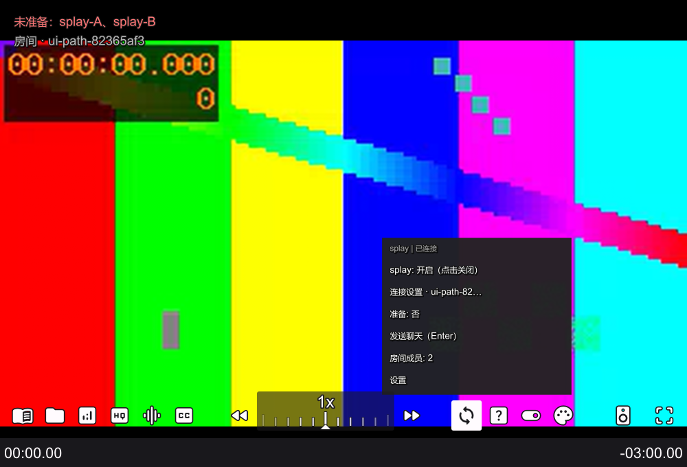
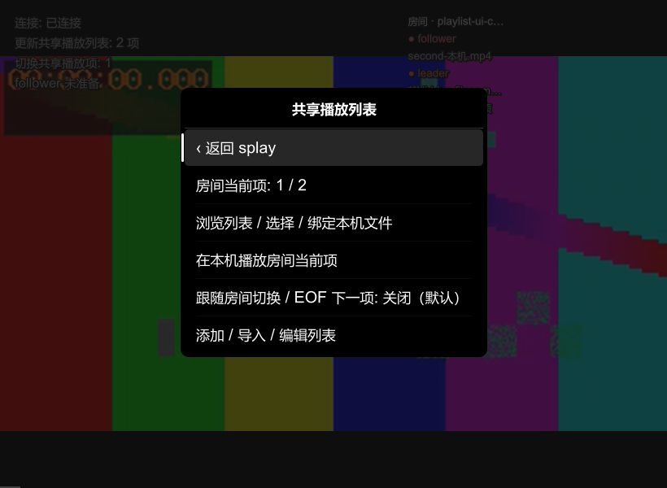

# splay

[](https://github.com/noxowin/splay/actions/workflows/windows.yml)
[](LICENSE)

为现有 mpv 添加 Syncplay 同步播放、房间、聊天与共享播放列表，无需额外运行 Syncplay 客户端。

**[下载 Windows x64 预览版](https://github.com/noxowin/splay/releases/tag/v0.1.0-preview.4)** · [安装与使用](docs/install.md) · [更新记录](CHANGELOG.md) · [问题反馈](https://github.com/noxowin/splay/issues)

当前版本 **v0.1.0-preview.4**，仍处于开发预览阶段。splay 是独立项目，并非 Syncplay 或 mpv 的官方发行版。

## 功能

- 与 Syncplay 服务器及官方客户端同步播放、暂停和跳转；支持成员、准备状态与受控房间。
- 播放器内聊天、近期消息历史；左上角显示短时消息，右上角显示房间信息，播放时随鼠标闲置隐藏。
- 记住多组连接信息；服务器密码以 Windows 当前用户加密保存，支持删除或停用。
- 房间共享播放列表：添加、导入本机队列、排序、选集，以及可选的本机跟随和播完下一项。
- 每次启动默认关闭，按需启用；支持独立图标菜单与可选的 uosc 控制条入口。

## 快速开始

1. 下载 Release 中的 `splay-windows-x64-preview4.zip`，关闭播放器。
2. 将包内以下四个文件放入 mpv **实际配置目录**下的 `scripts` 文件夹；升级时全部替换，不覆盖其他配置。

   ```text
   scripts/splay.lua
   scripts/splay_core.dll
   scripts/splay_overlay.lua
   scripts/splay_playlist.lua
   ```

3. 正常打开视频，按 **Shift+s** 或点击底部同步图标，启用 splay 并连接房间。默认服务器为 `syncplay.pl:8999`、昵称为 `splayuser`，房间需自行填写或选择。
4. 连接后按 **Enter** 输入聊天，再按 Enter 发送，Esc 取消；**Shift+h** 查看本次进程的消息历史。

便携版配置通常位于 `mpv.exe` 旁的 `portable_config`。完整安装、校验与快捷键冲突处理见 [使用指南](docs/install.md)。GitHub 的 Source code 压缩包不含已编译 DLL。

同步不传输视频，各成员需自行获取媒体。加入房间保留当前视频和调用参数；共享列表的本机跟随默认关闭，未知网络地址需逐项确认。

## 界面

以下截图使用合成测试视频。



<details>
<summary>查看状态、聊天与共享播放列表</summary>




</details>

## 兼容与开发

需要支持 C 插件和 `mp.input` 的 Windows x64 mpv；uosc 可选。已测 mpv 0.41 开发构建、uosc 5.12/5.13 与 Syncplay 1.7.6，具体版本和限制见 [验证记录](docs/validation-v4.md)。完整整合包、真实浏览器鉴权链及最低兼容版本尚未全面验证。

构建与测试见 [贡献指南](CONTRIBUTING.md)，内部接口见 [架构说明](docs/architecture.md)。[上游兼容说明](docs/upstream-compatibility.md) 介绍官方更新对本项目的影响。

原创代码采用 [GPL-3.0-only](LICENSE)；第三方组件保留各自许可，见 [第三方声明](THIRD_PARTY_NOTICES.md)。安全问题请按 [SECURITY.md](SECURITY.md) 反馈。
