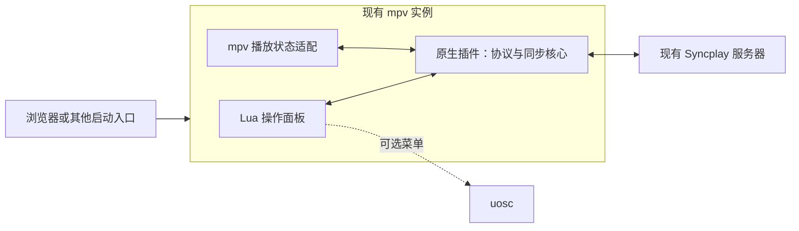

# 架构与插件边界

状态：Windows x64 开发预览实现。原生核心为 C++17，网络为 Winsock，TLS 为 Windows Schannel；实际宿主与验证结果见 [本轮验证记录](validation-v3.md)。最低兼容版本尚未确定。

## 分层



- **同步核心**：服务器连接、协议解析、房间与成员状态、操作员权限、延迟估计和同步决策。尽量不依赖 mpv 界面，便于测试和未来复用。
- **mpv 适配层**：观察播放属性和生命周期，将本地操作映射到核心，将远端状态应用到当前播放器。
- **Lua 界面**：服务器与房间输入、成员列表、准备状态、连接和同步开关。界面与核心通过结构化消息交换数据。
- **Lua 屏幕显示**：独立的 `splay_overlay.lua` 展示同步图标与紧凑菜单，仅在启用后展示准备状态、播放事件和聊天；从主界面接收菜单模型、状态和事件，不实现网络协议。
- **连接历史**：原生 `History` 模块仅保存允许的非密码字段，通过文件锁、读取后合并、临时文件替换保护跨进程保存。默认值与历史恢复由主界面协调，不触发自动连接。
- **可选 uosc 适配**：使用已有菜单 API；缺少 uosc 时仍能完成连接、准备和退出操作。

Windows 原生组件使用 mpv C 插件 DLL 接口。通过 `MPV_CPLUGIN_DYNAMIC_SYM` 使用当前宿主提供的 API，不链接另一份 libmpv。DLL 与 Lua 通过 `script-message-to` 交换结构化 JSON；接口见 [实施计划](implementation-plan.md)。网络线程只处理传输，mpv API 均由插件主循环调用。

参考：[mpv C plugins](https://mpv.io/manual/stable/#c-plugins)。

## 配置与安装

发行包的运行文件如下，另附安装说明和第三方许可：

```text
scripts/
  splay_core.dll
  splay.lua
  splay_overlay.lua
script-opts/
  splay.conf.example
```

安装前确认 mpv 实际使用的配置目录。Windows 的 `portable_config`、`MPV_HOME` 和启动参数都可能改变加载位置；`--no-config` 或 `--load-scripts=no` 可能阻止自动加载。

仅新增插件自己的文件。已有 `mpv.conf`、`input.conf`、`uosc.conf` 通过安装说明提供可合并片段，不整份替换。示例配置不包含真实密码或房间凭据。

uosc 的 `set-button` 注册按钮后，仍需用户把 `button:splay` 加入自己的 `controls`；不能把注册按钮描述为自动修改控制条。自有菜单使用唯一标识，更新或关闭时不影响其他插件的菜单。

自带的屏幕按钮独立于 uosc controls，鼠标移到底部时显示，只在可见按钮区域接管左键，菜单打开时停止接管。配置历史位于实际 mpv 配置目录的 `splay-history.json`，不会写入 `mpv.conf` 或 `input.conf`。历史恢复与显示开关等接口见 [本轮设计](iteration-2.md)。

参考：[Windows 配置目录](https://mpv.io/manual/stable/#files-on-windows)、[uosc 扩展接口](https://github.com/tomasklaen/uosc/wiki)、[Menu API](https://github.com/tomasklaen/uosc/wiki/Menu-API)。

## 协议与状态

实现接入未修改的 Syncplay 1.7.6 服务器，与同版官方客户端联调。协议参考该版本的 `protocols.py`、`client.py`、`server.py`；旧版网页协议说明用于理解，不作为完整规范。项目不包含 Syncplay 的实现代码。

基础消息包括握手、成员/房间更新、列表、播放状态、聊天、错误与心跳。聊天通过服务端能力协商，按 Unicode 码点遵守消息长度。播放活动事件从权威状态的操作者和变更生成，心跳、首次基线及受控房拒绝的普通成员动作不重复显示。同步核心处理延迟估计和 `ignoringOnTheFly` 确认；主动跳转、首次对齐或位置差超过 1.5 秒时跳转纠偏。该阈值是实现策略，并非精度保证。未采用临时改变播放速度的纠偏方法。

连接层在发送 Hello 前协商 STARTTLS。仅 `prefer` 遇到服务器明确不支持 TLS 时允许明文；握手/证书失败不降级。传输具有消息大小、队列大小和网络操作超时限制，断开时取消并回收工作线程。首版支持 TLS 1.2，使用系统证书校验和缓存证书材料。

操作员认证与服务器密码分开处理。受控房间的操作员权限不等同于入房密码；首版不扩展踢人、封禁或禁言协议。

状态分别记录：

- 连接：断开、连接中、已连接、失败；重连是手动发起的新连接。
- 房间：当前房间、自己与成员的准备状态、自己是否具有控制权。
- 播放器：空闲、加载中、可播放、缓冲中、媒体结束。
- 同步：首次对齐、待确认的本地操作、待确认的服务端强制状态；加载/缓冲/非 1x 状态通过提示解释同步限制。

参考：[官方协议说明](https://syncplay.pl/about/protocol/)、[协议源码](https://github.com/Syncplay/syncplay/blob/master/syncplay/protocols.py)、[TLS 文档](https://github.com/Syncplay/syncplay/wiki/TLS-support)。

## 当前媒体与浏览器调用

加入同步时不重新打开视频；适配层只写入 `pause` 和 `time-pos`，不写媒体 URL、Cookie、请求头、字幕、音轨或播放速度。退出后停止控制播放属性。真实 HTTP 测试与未覆盖的浏览器场景见验证记录。

始终以 `**Hidden filename**`、时长和大小 0 上报媒体，不共享完整媒体 URL、鉴权参数或本地完整路径。成员需要能独立获取相同内容，并拥有可比较的时间轴；插件不会自动判断两个视频是否相同。加载或缓冲产生的暂时状态不作为用户主动操作广播。

共享播放列表、自动打开他人的 URL、直播、带广告的动态时间轴和平台资源解析属于后续单独设计的范围。

## 源码目录

```text
src/core/          协议、房间模型与同步策略
src/net/           Winsock、STARTTLS 和 Schannel
src/mpv/           原生插件入口和播放状态适配
scripts/splay.lua  Lua 界面与可选 uosc 适配
scripts/splay_overlay.lua 状态文字、聊天和鼠标按钮
tests/             协议、同步状态机和集成验证
tools/             构建与白名单打包
packaging/         安装、卸载说明
third_party/       固定的 JSON 和 mpv API 头文件及许可
docs/              设计、兼容记录和使用说明
```

编译器运行库静态链接；包内不带播放器、Python、Syncplay 客户端或其他插件。

## 后期集成版

优先复用同一插件，将固定版本的 mpv、插件、默认配置和更新流程组合发行。集成播放器可以单独维护构建仓库，不把整套 mpv/FFmpeg 工具链作为独立插件的必需依赖。只有确认插件接口无法满足需求后，才评估维护 mpv 核心补丁。
