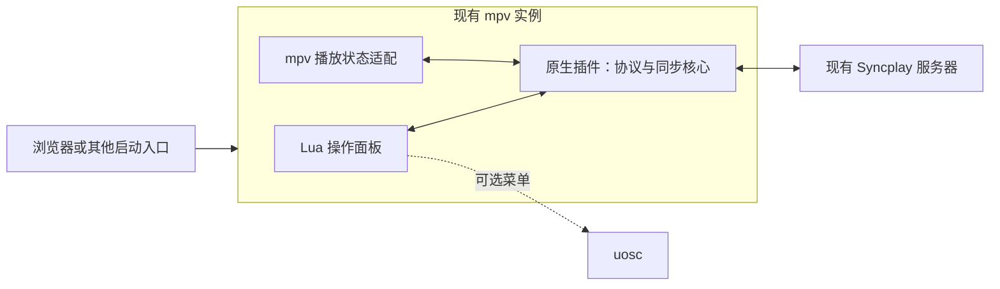

# 架构与插件边界

状态：设计提案。没有运行验证，编程语言、最低 mpv 版本和网络依赖尚未锁定。

## 分层



- **同步核心**：服务器连接、协议解析、房间与成员状态、操作员权限、延迟估计和同步决策。尽量不依赖 mpv 界面，便于测试和未来复用。
- **mpv 适配层**：观察播放属性和生命周期，将本地操作映射到核心，将远端状态应用到当前播放器。
- **Lua 界面**：服务器与房间输入、成员列表、准备状态、连接和同步开关。界面与核心通过结构化消息交换数据。
- **可选 uosc 适配**：使用已有菜单 API；缺少 uosc 时仍能完成连接、准备和退出操作。

Windows 原生组件拟采用 mpv C 插件 DLL 接口。按官方要求使用宿主提供的 API，并定义 `MPV_CPLUGIN_DYNAMIC_SYM`；不通过链接另一份 libmpv 来访问当前播放器。DLL 与 Lua 的通信可基于 `script-message-to`，具体消息格式和宿主导出能力在第一阶段验证。

参考：[mpv C plugins](https://mpv.io/manual/stable/#c-plugins)。

## 配置与安装

拟议的发行包布局如下，当前这些文件尚不存在：

```text
scripts/
  splay_core.dll
  splay.lua
script-opts/
  splay.conf.example
```

安装前确认 mpv 实际使用的配置目录。Windows 的 `portable_config`、`MPV_HOME` 和启动参数都可能改变加载位置；`--no-config` 或 `--load-scripts=no` 可能阻止自动加载。

仅新增插件自己的文件。已有 `mpv.conf`、`input.conf`、`uosc.conf` 通过安装说明提供可合并片段，不整份替换。示例配置不包含真实密码或房间凭据。

uosc 的 `set-button` 注册按钮后，仍需用户把 `button:splay` 加入自己的 `controls`；不能把注册按钮描述为自动修改控制条。自有菜单使用唯一标识，更新或关闭时不影响其他插件的菜单。

参考：[Windows 配置目录](https://mpv.io/manual/stable/#files-on-windows)、[uosc 扩展接口](https://github.com/tomasklaen/uosc/wiki)、[Menu API](https://github.com/tomasklaen/uosc/wiki/Menu-API)。

## 协议与状态

目标是接入未修改的 Syncplay 服务器。实现以选定版本的官方 `protocols.py`、`client.py`、`server.py` 为基准；旧版网页协议说明用于理解，不作为完整规范。

基础消息包括握手、成员/房间更新、列表、播放状态、错误与心跳。同步还需处理延迟估计、主动操作的确认与旧状态抑制，不能收到任意远端位置就直接跳转。连接层需要验证 STARTTLS 协商、证书验证和旧服务器兼容策略，并清楚显示实际连接状态。

操作员认证与服务器密码分开处理。受控房间的操作员权限不等同于入房密码；首版不扩展踢人、封禁或禁言协议。

建议把以下状态独立记录：

- 连接：断开、连接中、认证中、已连接、重连中、失败。
- 房间：当前房间、自己与成员的准备状态、自己是否具有控制权。
- 播放器：空闲、加载中、可播放、缓冲中、媒体结束。
- 同步：未加入、等待媒体、跟随中、应用远端操作中、暂停同步。

参考：[官方协议说明](https://syncplay.pl/about/protocol/)、[协议源码](https://github.com/Syncplay/syncplay/blob/master/syncplay/protocols.py)、[TLS 文档](https://github.com/Syncplay/syncplay/wiki/TLS-support)。

## 当前媒体与浏览器调用

加入同步时不重新打开视频，不改变媒体 URL、Cookie、请求头、字幕和音轨。仅在必要时更新播放状态。退出后移除同步控制并恢复由插件临时调整的参数，不能覆盖用户在此期间作出的新选择。

默认不共享完整媒体 URL、鉴权参数或本地完整路径。成员需要能独立获取相同内容，并拥有可比较的时间轴；仅凭文件名、时长相近不能断言媒体相同。加载或缓冲产生的暂时状态不能误广播为用户主动操作。

共享播放列表、自动打开他人的 URL、直播、带广告的动态时间轴和平台资源解析属于后续单独设计的范围。

## 计划源码目录

```text
src/core/          协议、连接、房间模型与同步策略
src/mpv/           原生插件入口和播放状态适配
scripts/splay/     Lua 界面与可选 uosc 适配
tests/             协议、同步状态机和集成验证
packaging/         自有文件的安装、卸载与发行包生成
docs/              设计、兼容记录和使用说明
```

目录在开始对应实现时创建，避免把空文件或占位代码误当成已有功能。

## 后期集成版

优先复用同一插件，将固定版本的 mpv、插件、默认配置和更新流程组合发行。集成播放器可以单独维护构建仓库，不把整套 mpv/FFmpeg 工具链作为独立插件的必需依赖。只有确认插件接口无法满足需求后，才评估维护 mpv 核心补丁。
